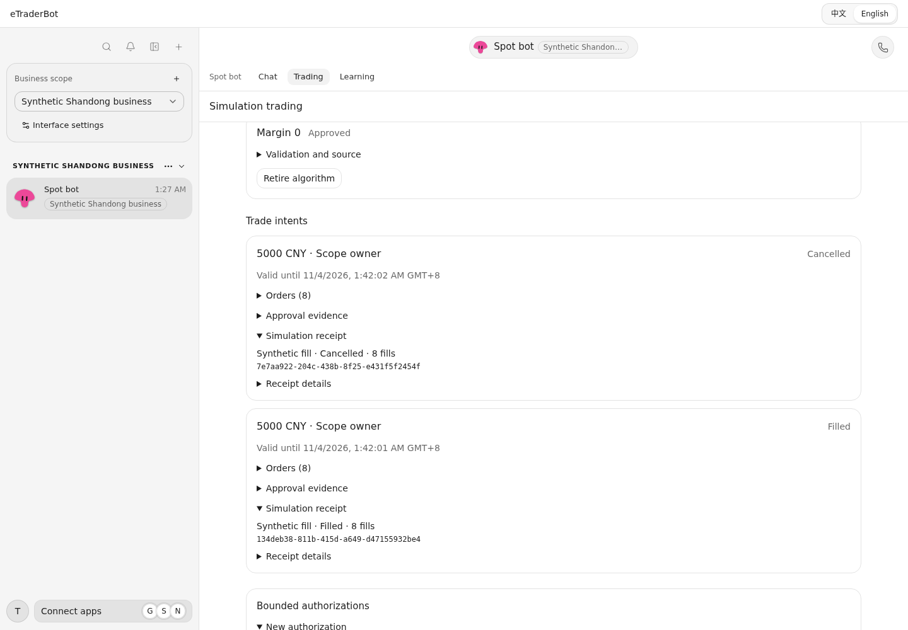

<p align="center">
  
</p>

# eTraderBot

**An electricity-trading workspace built around business scopes, specialized bots, and human approval.**

[简体中文](./README.zh-CN.md) · English · [日本語](./README.ja.md)

Create a business scope, add the bots that work on it, and keep its data connections, decisions, approvals, and learning evidence together. eTraderBot extends [Rakazo](https://github.com/elie222/rakazo) with electricity-trading workflows for retailers, generators, and standalone storage operators.

**Current stage: V1 simulation workflows.** The application runs with built-in synthetic data. Company data adapters and live trading are not connected. Paper algorithm implementation is deferred; the current algorithms are engineering baselines, and strategy improvement has not been established on real data.



*An automated browser-test scene with synthetic accounts and orders.*

## How it works

1. **Choose a business scope.** A scope is the workspace for a business's bots, conversations, materials, and interfaces. Each bot belongs to one scope.
2. **Create a bot from a template.** Trading capabilities live inside bots, alongside Chat and Learning.
3. **Review a decision.** Preserve the input snapshot, rules, algorithm version, order intent, and approval evidence.
4. **Approve and simulate.** Algorithm enablement and trade authorization are separate human decisions. Trading requires either approval of the exact intent or an active bounded authorization.
5. **Reconcile and learn.** Track partial fills, uncertain outcomes, cancellations, and quota accounting. Use authorized evidence to propose parameter candidates, which require human approval before use.

### Four bot templates

| Template | Responsibility | Trading tool permissions |
| --- | --- | --- |
| Mid / long term | Contract and exposure analysis in the mid / long-term stage | Analyze, prepare intents, and execute authorized simulations |
| Spot | Day-ahead, intraday, and real-time stages in one bot | Analyze, prepare intents, and execute authorized simulations |
| Risk | Inspect exposure, limits, and approval evidence | Inspect and reconcile existing orders; cannot submit or cancel them |
| Review | Review decisions, receipts, and audit records | Inspect and reconcile existing orders; cannot submit or cancel them |

Permissions come from server-side roles and scope bindings. Changing a bot's name or instructions does not change its authority. A person's approval role is separate from the bot's tool permissions.

## What V1 includes

- **Business workspaces:** one business scope per Space, bot ownership labels, scope switching, and an All Bots navigation view.
- **Three engineering baselines:** retailer exposure allocation, generator incremental offers, and storage schedules constrained by energy, power, efficiency, and terminal reserve.
- **Reviewable decisions:** fixed input snapshots, versioned algorithms and parameters, replay, immutable approval evidence, and audit history.
- **Controlled execution:** independent algorithm and trade approval; per-intent approval or bounded authorization by executor, version, expiry, and limits.
- **Execution lifecycle:** full and partial fills, submission timeout, rejection, pending orders, cancellation timeout, and persistent venue unavailability. Receipt history and quota reservations survive retries; uncertain orders retain their reservations.
- **Scoped learning:** daily schedules and manual triggers, authorized chat/file/operation/history sources, parameter candidates, constraint comparison, and human enablement. Learning runs cannot execute or cancel trades.
- **Interface configuration:** HTTP data API settings and references to available MCP connections, grouped by purpose within each business scope. Secrets are stored separately from visible configuration.
- **Chinese / English UI:** shared Web and Electron workflows; mobile supports scope navigation, receipt history, approvals, reconciliation, and human cancellation. Detailed scope, interface, scenario, and authorization configuration is currently on Web.

**Weather forecasts support HTTP pull and authenticated external push**, with a simulator for an internal weather model interface. Start `pnpm weather:simulator` and follow the [weather integration guide](./docs/integration/eTraderBot-weather-api.md). Bound bots can query persisted forecasts with explicit synthetic provenance.

Saving other interface configurations does **not** establish connectivity. Weather does not automatically feed the trading baseline; other company data mapping and execution adapters remain follow-up work. Choosing Shanghai, Jiangsu/Suzhou, or Shandong records the business location; it does not certify local market rules.

## Run from source

The current V1 checkpoint is on `feat/etraderbot-v1`. Use this repository's source to run these features; the upstream Rakazo images and app-store downloads are separate releases.

### Prerequisites

- Node.js matching `package.json`: 22.22.2+ in the 22.x line, 24.x, or 26+.
- pnpm 9; the repository pins its version in `package.json`.
- Docker Engine or Docker Desktop, the Compose plugin, and OpenSSL.

```bash
git clone --branch feat/etraderbot-v1 https://github.com/ShaySha-PRa/eTraderBot.git
cd eTraderBot
cp .env.example .env
pnpm install --frozen-lockfile
```

Edit `.env` before starting. Generate a **different value for each secret**:

| Setting | Value |
| --- | --- |
| `POSTGRES_PASSWORD`, `POSTGRES_APP_PASSWORD` | Separate values from `openssl rand -hex 16` |
| `DATABASE_MIGRATION_URL` | Replace its password placeholder with `POSTGRES_PASSWORD` |
| `DATABASE_URL` | Replace its password placeholder with `POSTGRES_APP_PASSWORD` |
| `BETTER_AUTH_SECRET`, `ENCRYPTION_KEY`, `SCREEN_PROXY_SECRET`, `SANDBOX_SUPERVISOR_TOKEN` | Separate values from `openssl rand -hex 32` |

The example database URLs use `127.0.0.1:5433`. Start that database, build the default Docker computer image, and run the application:

```bash
docker compose --env-file .env \
  -f infra/compose/docker-compose.yml \
  -f infra/compose/docker-compose.postgres-host.yml \
  up -d postgres

pnpm sandbox:build
pnpm dev
```

`pnpm dev` generates the Prisma client, applies migrations, and starts the API, worker, Web app, and sandbox supervisor. Branches with additional migrations get a separate development database. Use the printed URL, normally [http://localhost:5173/app](http://localhost:5173/app); occupied default ports cause development startup to choose another port block.

Configured database connection failures stop startup instead of switching to another database. Existing branch databases and files remain selected after their migrations merge; ordinary startup never cleans them up. To keep a specific dataset across branches, set its database URLs and matching absolute `DATA_DIR`, then run `pnpm dev --existing`. See [startup and data preservation](./docs/implementation/eTraderBot-foundation-01-startup.md#日常启动和恢复) for selection, first-copy requirements, and recovery.

For host-side development with Docker Desktop, set `SANDBOX_CONTROL_VIA_LOOPBACK=true` in `.env`. In WSL, keep the repository and data directory in the Linux filesystem. See the [source-development guide](./docs/self-host.md#local-source-checkout) for details.

Create an account, connect a compatible model through the application's connection settings, then create a business scope and a bot. Built-in synthetic analysis does not require a company API; bot conversation and model-driven learning require a model connection.

`LOCAL_AUTO_LOGIN_EMAIL` is empty by default. For local development, it can name an **existing** account to bypass login and identity confirmation. This mode requires development settings and loopback addresses; leave it empty for normal sign-in.

### Desktop and mobile

With the development stack running:

```bash
pnpm --filter @rakazo/desktop dev
```

Choose **Existing instance** and enter the running Web URL. The desktop shell's **This computer** installer uses upstream published images rather than this source checkpoint. Mobile build instructions are in the [mobile guide](./docs/mobile-release.md); native-device validation of these V1 trading changes remains pending.

The `rakazo` package names, environment names, and internal identifiers are retained for compatibility.

## Try the simulation workflow

In the sidebar, create a business scope and select its subject, account, location, market, and product. Create a **Spot** bot, open **Trading**, and choose a stage.

Run an analysis, prepare an intent, approve its algorithm, and then approve the trade or create a bounded authorization. Before submitting a new order, the scope owner can choose a **Simulation scenario**, such as partial fill or cancellation timeout. Use **Reconcile order** to track the existing submission and **Cancel order** when authorized; the receipt history and settled/reserved amounts remain visible.

Open **Learning** to add materials, edit the daily schedule, or select **Learn now**. A candidate passing deterministic constraints is still pending human enablement, and enabling it does not grant permission to trade. Bot cancellation also requires an explicit, active cancellation permission on its original authorization.

## Validation and remaining work

The [foundation acceptance summary](./docs/implementation/eTraderBot-foundation-acceptance.md) closes tasks 01–09 through targeted tests, independent browser acceptance, and a real-model team exercise using synthetic business data. It separates real-model recovery from deterministic tests at the write boundary and retains known test failures and unverified areas; it does not establish full-repository CI or production trading readiness.

The [V1 acceptance record](./docs/implementation/eTraderBot-v1-acceptance.md) retains earlier checkpoints, including 81 trading PostgreSQL tests, 17 row-isolation tests, 51 unit/contract/mobile-component tests, and 5 Chromium scenarios passing. Their type checks and Web build also passed. Those counts describe that earlier checkpoint, not the foundation stage or a new combined test run.

Useful commands:

```bash
pnpm exec vitest run packages/core/src/trading packages/contracts/src/trading-workspace.test.ts apps/mobile/lib/trading-screen.test.tsx
pnpm test:integration --spec=trading
pnpm test:integration --spec=row-security.postgres
LOCAL_AUTO_LOGIN_EMAIL= pnpm test:e2e '--spec=(trading|trading-templates|ui-locale)\.spec\.ts'
pnpm --filter @rakazo/web build
```

Run the database and browser harnesses sequentially. They use isolated test infrastructure; Electron E2E and native-device checks are separate.

Remaining work includes company adapter connectivity and mapping, live execution integration, calibrated model evaluation, real-data strategy validation, cross-user experience sharing, and native-device acceptance. Paper algorithms remain deferred. Repository fixtures include synthetic cases and attributed public reference material; consult the [fixture validation record](./docs/integration/eTraderBot-fixture-validation.md) before treating them as valid algorithm inputs.

## Documentation

| Document | Purpose |
| --- | --- |
| [Foundation acceptance](./docs/implementation/eTraderBot-foundation-acceptance.md) | Tasks 01–09, evidence levels, known failures, and remaining validation |
| [V1 spec](./docs/specs/eTraderBot-v1-spec.md) | Confirmed scope, permissions, and deferred work |
| [Implementation progress](./docs/implementation/eTraderBot-v1-progress.md) | Delivered batches and remaining milestones |
| [Acceptance matrix](./docs/implementation/eTraderBot-v1-acceptance.md) | V01–V14 evidence and validation limits |
| [Business workspaces and interfaces](./docs/implementation/eTraderBot-business-workspaces-api.md) | Scope ownership and HTTP/MCP configuration |
| [Trading approval and execution](./docs/implementation/eTraderBot-trading-control-api.md) | Intents, grants, receipts, reconciliation, and cancellation |
| [Learning](./docs/implementation/eTraderBot-learning-api.md) | Schedules, evidence, candidates, and approvals |
| [External interface list](./docs/integration/eTraderBot-interface-list.md) · [OpenAPI](./docs/integration/eTraderBot-external-api.openapi.json) | Adapter handoff contracts |
| [Configuration](./docs/self-host-configuration.md) · [Backups](./docs/self-host-backups.md) | Inherited runtime operations guidance |

```text
apps/       Web, API, worker, Electron, Expo, and upstream website
packages/   contracts, algorithms, persistence, adapters, shared UI, test tooling
docs/       specs, implementation records, integration contracts, operations
infra/      Compose services and computer images
```

## Contributing and attribution

Read [CONTRIBUTING.md](./CONTRIBUTING.md) and [AGENTS.md](./AGENTS.md) before changing the code. Preserve scope isolation, separate human approval from model output, and include evidence for changes to execution or learning behavior.

eTraderBot builds on [Rakazo](https://github.com/elie222/rakazo) and retains its [Apache License 2.0](./LICENSE). Upstream runtime and operations documentation may still use the Rakazo name; the eTraderBot spec and acceptance record define the trading features delivered here.
