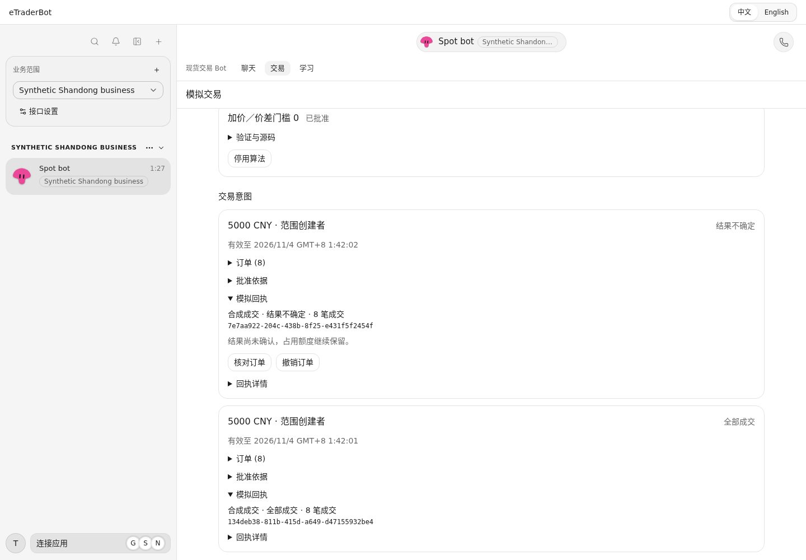

<p align="center">
  
</p>

# eTraderBot

**按业务范围组织 Bot，由人控制交易权限的电力交易工作台。**

简体中文 · [English](./README.md) · [日本語](./README.ja.md)

eTraderBot 面向售电公司、发电企业和独立储能交易场景。先创建业务范围，再为该业务创建交易、风控与复盘 Bot，把数据接口、会话、决策、审批、回执和学习资料放在同一工作区中。项目基于 [Rakazo](https://github.com/elie222/rakazo) 扩展，复用其 Bot、记忆、任务、连接和多端应用能力。

**当前阶段：V1 模拟流程。** 内置合成数据可用于跑通业务；真实公司数据适配器与实盘交易尚未接入。论文算法实现已暂缓，目前使用可重放的工程基线，尚无真实数据上的策略改进或收益验证结论。



*截图来自自动化浏览器测试，业务和订单均为合成样例。*

## 使用流程

1. **选择业务范围。** 一个业务范围就是一个工作区，集中管理该业务的 Bots、会话、资料与接口；每个 Bot 只归属一个业务。
2. **创建模板 Bot。** 交易能力内置于 Bot，通过“聊天／交易或检查／学习”切换。
3. **查看候选决策。** 固定输入快照、规则、算法版本、订单意图和审批依据。
4. **人工批准并模拟执行。** 算法启用与交易授权分别审批；交易使用逐笔批准或有效的限额授权。
5. **核对结果并学习。** 跟踪部分成交、超时、撤单和额度变化，用授权资料提出参数候选，再由人决定是否启用。

### 四种 Bot 模板

| 模板 | 职责 | 交易工具权限 |
| --- | --- | --- |
| 中长期交易 | 中长期阶段的合同与敞口分析 | 分析、准备意图、执行有授权的模拟交易 |
| 现货交易 | 同一 Bot 内的日前、日内、实时业务 | 分析、准备意图、执行有授权的模拟交易 |
| 风控 | 检查敞口、限额及批准依据 | 查看证据、核对既有订单；不能下单或撤单 |
| 复盘 | 关联决策、回执及审计记录 | 查看证据、核对既有订单；不能下单或撤单 |

权限由后端角色和业务绑定决定，修改 Bot 名称或提示词不会扩大权限。人的审批资格与 Bot 的工具权限分别检查。

## 已实现能力

- **业务工作区：** 业务范围与 Space 一一对应，支持业务切换、Bot 归属标签和“全部 Bots”导航。
- **三类工程基线：** 售电净敞口分配、发电增量报价、受电量／功率／效率／终端储备约束的储能计划。
- **可追溯决策：** 固定输入、算法与参数版本、重放、不可改写的审批依据和审计记录。
- **交易权限控制：** 算法与交易独立审批；逐笔批准或按执行者、版本、期限、单笔与累计限额授予权限。
- **模拟执行生命周期：** 全部／部分成交、提交超时、拒单、挂单、撤单超时、场所持续不可用；保存回执历史、额度占用与核销，不确定订单继续占用额度。
- **业务内学习：** 每日和手动触发，显式授权的聊天／文件／操作／历史资料，参数候选、约束对照和人工启用。学习运行不能执行交易或撤单。
- **接口配置：** 按行情、预测、持仓、规则、执行、回执等用途配置 HTTP 数据 API，或选择可用的 MCP 连接；敏感值单独保存。
- **中英界面与多端入口：** Web 和 Electron 共用业务页面；移动端支持业务导航、回执历史、审批、核对和人工撤单。详细业务、接口、场景及授权配置当前在 Web 完成。

**天气数据现支持 HTTP 主动拉取和外部推送**，并提供公司内部天气模型接口模拟器；启动 `pnpm weather:simulator` 后按[天气接入说明](./docs/integration/eTraderBot-weather-api.md)配置。预测供所属业务的 Bot 查询，明确标记模拟来源。

保存其他接口配置不等于接通接口，也不会自动把天气或 API 响应用于交易计算。其他公司数据映射与执行适配仍待实现和联调。上海、江苏／苏州、山东是业务地点配置，当前合成规则不代表这些地区的实际市场规则已获验证。

## 本地启动

请从本仓库 `main` 分支的源码运行。上游 Rakazo 的预构建镜像和应用商店下载属于另一套发布产物。

### 环境要求

- Node.js：22.x 中的 22.22.2 及以上版本、24.x，或 26 及以上版本，具体以 `package.json` 为准。
- pnpm 9，项目在 `package.json` 中固定版本。
- Docker Engine 或 Docker Desktop、Compose 插件、OpenSSL。

```bash
git clone https://github.com/ShaySha-PRa/eTraderBot.git
cd eTraderBot
cp .env.example .env
pnpm install --frozen-lockfile
```

启动前编辑 `.env`，每个密钥分别生成，避免共用：

| 配置 | 填写方式 |
| --- | --- |
| `POSTGRES_PASSWORD`、`POSTGRES_APP_PASSWORD` | 分别运行 `openssl rand -hex 16` |
| `DATABASE_MIGRATION_URL` | 用 `POSTGRES_PASSWORD` 替换密码占位符 |
| `DATABASE_URL` | 用 `POSTGRES_APP_PASSWORD` 替换密码占位符 |
| `BETTER_AUTH_SECRET`、`ENCRYPTION_KEY`、`SCREEN_PROXY_SECRET`、`SANDBOX_SUPERVISOR_TOKEN` | 各自运行一次 `openssl rand -hex 32` |

示例数据库地址使用 `127.0.0.1:5433`。启动数据库，构建默认 Docker 计算机镜像，再运行应用：

```bash
docker compose --env-file .env \
  -f infra/compose/docker-compose.yml \
  -f infra/compose/docker-compose.postgres-host.yml \
  up -d postgres

pnpm sandbox:build
pnpm dev
```

`pnpm dev` 会生成 Prisma 客户端、应用迁移并启动 API、worker、Web 和沙箱 supervisor。包含额外迁移的分支使用独立开发数据库。打开终端打印的地址，通常为 [http://localhost:5173/app](http://localhost:5173/app)；默认端口被占用时会选择其他端口组。

使用 Docker Desktop 且服务在宿主机运行时，在 `.env` 设置 `SANDBOX_CONTROL_VIA_LOOPBACK=true`。WSL 下建议将仓库和数据目录放在 Linux 文件系统中。其他细节见[源码开发说明](./docs/self-host.md#local-source-checkout)。

注册账号，在应用连接设置中配置兼容模型，再创建业务范围和 Bot。内置合成分析不依赖公司 API；Bot 对话和模型驱动的学习需要模型连接。

`LOCAL_AUTO_LOGIN_EMAIL` 默认留空，使用正常登录。本地开发可填入一个**已存在账号**的邮箱，跳过登录与二次身份确认；该模式仅允许开发配置和本机回环地址。

### 桌面与移动端

本地服务运行后，可启动 Electron：

```bash
pnpm --filter @rakazo/desktop dev
```

选择 **Existing instance**，填入已运行的 Web 地址。桌面壳的 **This computer** 安装器使用上游预构建镜像，不会加载此源码版本。移动端构建见[移动发布说明](./docs/mobile-release.md)；当前 V1 交易改动仍待原生设备验收。

为兼容既有工程，`rakazo` 包名、环境变量名和内部标识暂时保留。

## 跑一遍模拟闭环

在侧栏新建业务范围，填写主体、账户、地点、市场与产品，然后创建“现货交易 Bot”，进入“交易”页并选择阶段。

运行分析、准备意图，先批准算法，再逐笔批准交易或创建限额授权。提交新订单前，业务所有者可在“模拟执行场景”选择部分成交、撤单超时等情况。提交后使用“核对订单”跟踪原请求，具有权限时使用“撤销订单”；回执历史、已核销与占用额度会保留显示。

进入“学习”页添加资料，调整每日计划或主动学习。候选通过确定性约束检查后仍需人工启用，启用算法也不会自动授予交易权限。Bot 撤单还要求其原限额授权明确允许撤单且保持有效。

## 验证与后续工作

[基座阶段验收汇总](./docs/implementation/eTraderBot-foundation-acceptance.md)记录任务 01–09 的收尾：定向测试、独立浏览器验收，以及使用合成业务资料的真实模型团队演练。真实模型下的恢复与写入边界的确定性测试分开说明，已知测试失败和未验证范围予以保留；不代表全仓 CI 或可用于真实交易。

[专项补验](./docs/implementation/eTraderBot-foundation-baseline-followup.md)已修复 testkit 类型错误及授权/checkpoint 两组基线失败（33/33、27/27），并通过受控时序的真实模型缓存工具撤权验证。完整 CI、原生端和 Graphile 多进程恢复仍未验证。

[V1 验收记录](./docs/implementation/eTraderBot-v1-acceptance.md)保留较早的检查点：81 项交易 PostgreSQL 测试、17 项行级隔离测试、51 项单元／契约／移动组件测试，以及 5 项 Chromium 场景通过，当时的类型检查和 Web 构建也已通过。这些数字描述的是那个检查点，不是基座阶段或新的合并测试结果。

常用验证命令：

```bash
pnpm exec vitest run packages/core/src/trading packages/contracts/src/trading-workspace.test.ts apps/mobile/lib/trading-screen.test.tsx
pnpm test:integration --spec=trading
pnpm test:integration --spec=row-security.postgres
LOCAL_AUTO_LOGIN_EMAIL= pnpm test:e2e '--spec=(trading|trading-templates|ui-locale)\.spec\.ts'
pnpm --filter @rakazo/web build
```

数据库和浏览器测试框架顺序运行，使用隔离测试环境；Electron E2E 与原生设备检查另行执行。

后续工作包括公司接口连通与映射、真实执行联调、经校准的模型评价、真实数据策略验证、跨使用者经验共享和原生设备验收。论文算法实现继续暂缓。仓库样例包含合成场景及注明来源的公开参考材料，使用前请查看[样例校验记录](./docs/integration/eTraderBot-fixture-validation.md)，不能把所有样例视为已通过算法输入检查。

## 文档导航

| 文档 | 内容 |
| --- | --- |
| [基座阶段验收](./docs/implementation/eTraderBot-foundation-acceptance.md) | 任务 01–09、证据层级、已知失败与待验证项 |
| [V1 Spec](./docs/specs/eTraderBot-v1-spec.md) | 已确认范围、权限与暂缓项 |
| [实施进度](./docs/implementation/eTraderBot-v1-progress.md) | 已完成批次与剩余阶段 |
| [验收矩阵](./docs/implementation/eTraderBot-v1-acceptance.md) | V01–V14 证据与验证边界 |
| [业务范围与接口](./docs/implementation/eTraderBot-business-workspaces-api.md) | 业务归属、HTTP/MCP 配置 |
| [交易批准与执行](./docs/implementation/eTraderBot-trading-control-api.md) | 意图、授权、回执、核对与撤单 |
| [学习流程](./docs/implementation/eTraderBot-learning-api.md) | 计划、资料、候选与审批 |
| [外部接口清单](./docs/integration/eTraderBot-interface-list.md) · [OpenAPI](./docs/integration/eTraderBot-external-api.openapi.json) | 接口实现交接契约 |
| [运行配置](./docs/self-host-configuration.md) · [备份恢复](./docs/self-host-backups.md) | 继承的运行维护说明 |

```text
apps/       Web、API、worker、Electron、Expo 和上游网站
packages/   契约、算法、持久化、适配器、共享 UI、测试工具
docs/       spec、实施记录、接口契约与运维说明
infra/      Compose 服务与计算机镜像
```

## 参与开发与致谢

修改代码前请阅读 [CONTRIBUTING.md](./CONTRIBUTING.md) 和 [AGENTS.md](./AGENTS.md)。涉及交易或学习流程时，应保留业务隔离、人工审批与模型输出的边界，并提供相应验证依据。

eTraderBot 基于 [Rakazo](https://github.com/elie222/rakazo) 开发，沿用 [Apache License 2.0](./LICENSE)。部分上游运行和运维文档仍保留 Rakazo 名称；本项目实际交付的交易功能以 eTraderBot spec 和验收记录为准。
