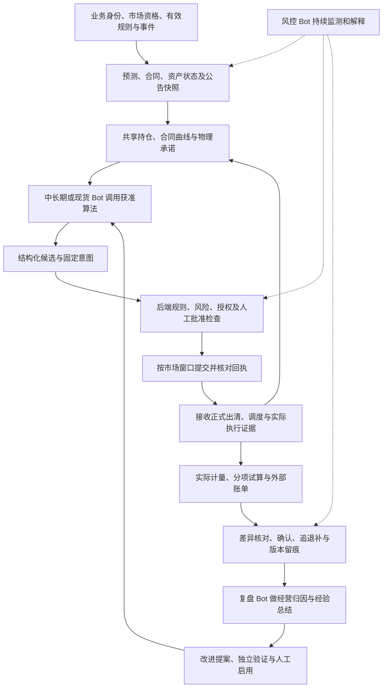

# 根据电力市场培训笔记复核四类 Bot 与业务流程

日期：2026-11-05。代码基准：`feat/etraderbot-v1`，`998c6bae`。性质：业务架构审查与改进建议，未将建议写成已批准决议，也未修改业务代码。

## 结论

**保留“每条业务一位主管＋中长期、现货、风控、复盘四类专业 Bot”。四类分工能够承载当前目标，但完整电力业务需要共享合同、物理资源、市场事件和计量结算能力。现有 V1 已有受控的模拟交易与学习提案流程，尚不能等同真实电力交易业务闭环。**

最需要修正的是三处关系：

1. 中长期、日前、日内、实时的授权可以分别管理；合同曲线、资产承诺和风险敞口需要关联计算。
2. 市场申报、出清、调度执行、计量、结算分别形成不同证据；订单成交不能直接生成“已交付、已结算、已盈利”的结论。
3. 各地区、产品、主体的申报资格和时序由适用规则决定；三个现货阶段不代表三个均可自由下单的市场。

这些是据课程机制及当前代码提出的架构判断。课程没有规定应该有几个 Bot，也没有证明强化学习优于其他交易算法。

## 证据范围

- 主来源是提供的培训班目录中 `P01/笔记.md` 至 `P37/笔记.md`。下文 `P25:69–102` 表示该课笔记的实际行号。各课的阅读记录与关键证据见文末。
- 本次审查笔记文字、表格和其中的材料说明；未独立观看原视频、重听音频或逐张复核图片。笔记声明曾核对原图，不代表本次也进行了图像验收。
- 课程的历史、国外和省级案例用于理解机制。只对少量国家层面原文作补充核验，未完成山东、江苏、上海各主体、各品种的现行规则审查。
- 代码核对覆盖交易契约、四类模板、业务与场景绑定、权限检查、算法、模拟执行、学习报告和现有架构／实施文档。“缺口”指这些路径尚未表达的业务能力，不是声称发生过真实交易事故。
- 本次没有运行交易、训练模型或重跑应用测试；已有实施记录中的测试结果不作为本次新执行的结果。

## 四个 Bot 应怎样分工

| 角色 | 判断与职责补充 | 交付物与权限边界 | 主要笔记依据 |
| --- | --- | --- | --- |
| 中长期 Bot | 保留；负责合同组合、年度至短周期滚动覆盖、合同曲线及变更／转让分析、结算参考点和现货敞口衔接 | 输出结构化合同组合、覆盖曲线、风险与候选申报；只能按已授权范围操作。金融合约与物理履约约束分开表达 | P04:268–298；P10:315–327；P16:224–240；P17:65–79；P29:150–186 |
| 现货 Bot | 保留；基于预测、共享持仓、资产状态及市场公告，准备允许的申报、跟踪出清与执行偏差，滚动更新可行方案 | 输出预测版本、申报曲线、外部结果对账和偏差解释。日前／日内／实时的可改字段及关闸时间按市场规则限定 | P10:126–185；P15:144–162；P25:235–249；P27:96–100、140–154 |
| 风控 Bot | 保留；贯穿事前、事中、事后，检查合同覆盖、量价及基差、信用与现金流、数据、履约能力、异常和规则适用性 | 读取业务证据、输出风险意见和告警。强制拦截由确定性的后端规则执行；现有禁止其准备／执行交易的边界保留。将来若赋予内部停用权，需独立授权 | P06:405–431；P11:220–238；P18:66–91；P19:302–315 |
| 复盘 Bot | 保留；建议职责明确包含“结算核对与经营复盘”，从决策过程延伸到实际履约、账单、收益归因和改进提案 | 输出暂估／确认结果、差异清单、收益成本分项和有适用条件的经验；读取正式证据，不直接改写外部计量、结算单、算法生产版本 | P11:96–189；P18:187–244；P25:69–102、235–249；P27:259–275 |

复盘 Bot 可以承担对账解释，计量采集、确定性费用计算和账单版本管理仍由共享服务完成。新建“结算 Bot”不是本轮必须项。

现有业务主管已经能派发本业务任务、查看进度及结果，且无交易审批或执行权；继续保留这个定位。看板完成率是任务状态统计，不能充当订单成功、交付完成或收益达标的指标。实现依据：[主管实施说明](../implementation/eTraderBot-business-supervisor.md#L7)。

## 当前架构做对的部分

1. **业务身份与作用范围。** 主体、账户、资产、地区、市场、产品、阶段及模拟／实盘环境都有结构化字段。这为不同经营主体分别核算、按规则参与市场提供了基础。地区适合组织导航，真实业务边界仍需主体、交易单元和资产身份。[范围契约](../../packages/contracts/src/trading.ts#L14)；P09:235–247，P27:323–339。
2. **专业职责与后端权限一起约束。** 中长期和现货按场景操作，风控和复盘没有交易写权限；不能仅靠聊天内容获取权力。[模板](../../packages/core/src/trading/bot-template.ts#L3)、[权限检查](../../packages/db/src/trading-bot-access.ts#L13)。这是工程治理选择，与课程区分经营主体、交易机构和调度机构的原则相容，不能说课程要求了这套 LLM 权限实现。
3. **算法启用和交易授权分开。** 当前有固定意图、版本核对、逐笔批准／范围授权、金额占用与幂等处理。它们值得保留；独立算法的存在本身不保证输入正确、决策盈利或物理可行。[执行服务](../../packages/db/src/trading-control.ts#L700)。
4. **模拟及学习证据有边界。** 输入标注合成来源，学习报告明确保留 `performanceConclusion: not_established`。应继续保持这种准确表述。[模拟快照](../../packages/core/src/trading/simulation.ts#L3)、[学习报告](../../packages/db/src/trading-learning.ts#L814)。
5. **普通 Bot 隔离和经验快照方向合理。** 工作区隔离已有首批实现；固定版本交接仍是待实施决议。交接包还应携带规则版本、适用市场／主体／产品、数据日期和例外条件，导入后重新验证。P34:122–128 展示历史补偿规则会变化，支持保留这些上下文；课程没有直接论证 Skill 或记忆机制。[隔离说明](../implementation/eTraderBot-v1.1-workspace-isolation.md#L3)、[交接决议](../adr/0005-versioned-experience-handoff.md)。

## 应优先补齐的六项业务能力

### 1. 共享合同、持仓和资产约束

**笔记直接证据：**中长期合约逐步覆盖实际发用电曲线；后续现货与合同有偏差和结算关系（P04:268–274、P25:69–102）。全电量竞价下的中长期差价合约不能自动当成固定物理出力（P17:65–79、P24:450–452）。辅助服务与电能量又共同使用资源能力（P06:145–165、P30:192–204）。

**代码现状：**每个阶段创建独立 `TradingDesk`，绑定与授权按阶段保存；输入已有 `contractedEnergyMwh`、`committedEnergyMwh`，储能也有 SOC、功率和效率约束，但尚未形成贯穿合同、出清、执行和结算的统一持仓及资源承诺记录。[场景创建](../../packages/db/src/trading-workspaces.ts#L92)、[输入契约](../../packages/contracts/src/trading.ts#L54)。

**建议：**在共享后端维护带时间区间的业务账本，至少区分合同电量、合同价与参考点、金融／物理属性、已申报／已出清量、执行计划、实际计量及剩余风险敞口。物理资产同时记录可用功率、爬坡、启停或 SOC 等适用约束，以及各产品的承诺。

阶段授权继续独立核查。若同一物理资产服务多个业务范围，后端也必须汇总其已授权承诺、避免超售；不能让 Bot 通过跨区文件写入实现共享。资源相容性按时段、方向、持续时间和规则计算，不能粗暴规定整台机组只能参加一个市场（P30:202）。

### 2. 按市场规则驱动申报和时序

**笔记直接证据：**有的实时市场沿用封存的日前报价，有的日内优化不是独立的日内交易；日前预出清与日前结算市场也不同（P10:126–137、P16:266–290、P19:169–197、P27:96–100、140–146）。省内预出清、省间结果及更新后的省内边界存在前后依赖（P13:207–231）。

**代码现状：**现货角色固定关联三个现货阶段；通用规则包含生效期、价格／电量步长及数据时效，但没有表达“谁能在何时申报什么、何时封存、是否仅接收结果”的业务能力。[阶段绑定](../../packages/db/src/trading-workspaces.ts#L92)、[规则契约](../../packages/contracts/src/trading.ts#L34)。

**建议：**为选定市场增加规则版本和事件日历，表达主体资格、报量／报价方式、报价曲线语义、开闭窗口、修改／撤回条件、前序结果依赖、出清结果修订及停市／恢复。规则来源仍以外部正式文件和交易平台为准。主管安排任务，后端检查市场事件和截止时间；聊天或看板状态不解锁申报权限。

P19:107–108 与 P24:334–339 的省份参与方式表存在差异，P19:192 与 P13:243 对“2 小时”的口径也不同。暂不能择一写成全国或全省通用常量。

### 3. 从回执延伸到计量、结算、对账和更正

**笔记直接证据：**P25:235–249 展示从持仓、预测与申报直到计量、预账单、异议、正式账单的完整链；P27:259–275 明确日清分、月结算及退补。结算还包含适用的辅助服务、偏差、补偿、分摊等项目（P18:187–244）。

**代码现状：**回执记录接收、部分成交、成交、拒绝、取消或未知，以及成交量价；它没有计量点、实际电量、暂估／正式账单和追退补的业务结构。[回执契约](../../packages/contracts/src/trading.ts#L140)。当前交易执行为模拟，不能据此宣称真正完成结算。

**建议：**分别记录申报接收、正式出清、调度／执行、实际计量、结算依据、账单确认和更正。保留数据源、版本、时间及关联关系；缺表或估算量应显式标识，不由 Bot 编造。内部试算与外部正式账单分开，差异进入人工核对／异议流程；更正追加版本，不覆盖既有事实。若经营目标包含资金回笼，还需接入财务收付款状态。

售电业务尤其需要区分批发采购、零售合同、应收应付和账期，零售未回款不自动消灭批发付款义务（P18:66–91）。复盘从这些证据计算收入、成本、偏差和净收益，不能以订单总额代替利润。

补充权威核验：国家《电力市场计量结算基本规则》第二十八条列举合同、出清、调度执行、计量等结算基础数据，第三十二条规定补推与追退补，第三十四条区分售电批发和零售结算。这与上述流程补齐方向一致。[国家发展改革委原文](https://zfxxgk.ndrc.gov.cn/web/iteminfo.jsp?id=20533)

### 4. 将风控意见与强制校验连接起来

**笔记直接证据：**输入校验要看完整性、合理性和关联性（P06:405–421）；风险监测侧重事前、事中并结合事后（P11:220–238）；信用、担保及财务风险具有独立业务意义（P16:49–55、P19:302–315）。

**代码现状：**已有数据时效、规则状态、意图一致性、未覆盖量、警告和单笔／累计金额检查，但不能由此推断已有组合信用、跨产品资产履约和结算风险模型。[快照校验](../../packages/core/src/trading/algorithms.ts#L49)、[意图校验](../../packages/db/src/trading-control.ts#L75)、[额度检查](../../packages/db/src/trading-control.ts#L755)。

**建议：**按具体业务增加确定性的输入一致性、合同／预测敞口、财务额度与担保、物理可交付、产品资格、市场窗口及外部结果冲突检查。风控 Bot 解释、排查和提出处理建议；强制拒绝、暂停与人工处置状态由后端依据正式授权执行。内部交易额度也不等同外部市场信用额度。

市场暂停、修改系统备用、安全校核豁免等属于运营／监管机构权限（P11:265–292、P27:123–154、P31:90–98）。本平台应接收这些外部状态并响应，不能靠主管或风控 Bot 自行取得机构权限。

### 5. 明确辅助服务及其他产品的业务范围

**笔记直接证据：**辅助服务需明确标的、周期、成员、需求、申报、出清、调用、计量和考核（P31:64–143）。MW 容量、调频里程／性能、MWh 电量不能混用；储能服务能力需要 SOC 与上下调能力（P08:404–432、P35:220–228）。

**代码现状：**虽有 `productId`，订单核心仍是买卖方向、MWh 和价格，没有备用保持时长、调频性能和调用考核等产品结构。[订单契约](../../packages/contracts/src/trading.ts#L123)。

**建议：**首个业务若只做电能量，可明确暂不支持辅助服务申报，但仍纳入实际影响该资产的外部承诺和相关结算费用。若业务确实要做调频／备用，再增加产品适配及逐时资源分配；专业 Bot 数量可以保持不变。容量补偿、容量市场、租赁收入、绿色价值分别核对资格与叠加条件，不能见到收益名称就生成可交易订单。

调频与能量可以在共同约束下并存，但有些补偿功能重叠、某些品种按特定规则互斥（P30:202、230–232；P33:300–306）。物理可行性、规则互斥、重复补偿是三类检查。

补充权威核验：国家《电力辅助服务市场基本规则》第七条区分经营主体与服务提供条件，第十二、十三条分别列出调度机构及交易机构职责，支持将内部交易决策与外部市场组织／调用分开。[国家发展改革委原文](https://zfxxgk.ndrc.gov.cn/wap/iteminfo.jsp?id=20504)

### 6. 算法按业务机制适配，学习按可验证结果评价

**代码现状：**当前是按售电、发电、储能区分的确定性基线，模拟使用固定四个小时的合成数据；学习主要提出 `margin` 候选并检查历史输入上的约束，未建立收益优越性。[算法](../../packages/core/src/trading/algorithms.ts#L169)、[合成数据](../../packages/core/src/trading/simulation.ts#L4)、[学习评估](../../packages/db/src/trading-learning.ts#L742)。

发电基线会从可用量中扣去 `committedEnergyMwh` 后申报剩余量（[代码](../../packages/core/src/trading/algorithms.ts#L237)）。这可用于已有物理承诺的简化模型；若把所有中长期差价合同都填入该字段，则可能错误排除本应参与全量现货竞价的出力。字段语义和适用市场必须先确定（P17:65–79、P24:450–452）。售电基线已有按缺口正负买卖的逻辑，本次未发现它被简单锁定为只买。

**建议：**算法输入输出绑定主体、产品、市场模式、预测与规则版本。依实际业务选择组合优化、情景分析、受约束优化或强化学习；企业经营目标与运营机构的社会福利／系统成本目标分别表达（P01:208–240、P06:76–165）。模型可模拟市场机制辅助判断，但无权发布正式出清结果。

学习先用历史可获得数据和已核对结果建立评价集，再比较收益成本、风险、履约和稳定性。训练与验证按时间和规则版本隔离，避免使用决策当时不可得信息；后者是本次工程建议，不能声称课件已经提供了完整机器学习验证方法。未知费用、缺失公式和历史制度冲突不能自动变成真实收益标签。交易员反馈可形成经验／候选；人工启用仍需与交易授权分别处理。

## 建议的业务工作流

下图是经营主体内部的业务视角。外部出清、调度、计量和结算由相应机构提供；平台接入和核对其证据。具体市场可以没有独立日内申报，结算也可能出现异议与多次更正，不能把图固化为所有地区的一条无条件串行流程。

主管沿用现有 Task/Run 派单、追踪阻塞和汇总结果。市场事件触发和截止时间检查放在共享业务服务；不再另建一套 Agent 调度器。普通提效 Bot 继续按工作区隔离，只读取获授权资料。

建议把业务状态分开表示：申报的“已接收／拒绝／未知”、市场的“预出清／正式出清／修订”、履约的“计划／实绩／缺失”、结算的“暂估／待核对／已确认／已更正”。这些是设计建议，外部状态的名称和映射由接口实际能力确定。未知回执需要查询和对账，不能直接重发造成重复申报。

## 用笔记里的一个案例检查是否真正跑通

P25:69–102 提供同一时段的教学案例：合同 100 MWh、300 元/MWh；日前 90 MWh、320 元/MWh；实时／实际 80 MWh、310 元/MWh。

按该例的双偏差口径：`100 × 300 + (90 − 100) × 320 + (80 − 90) × 310 = 23,700 元`。等价差价写法也应得到同一结果。

对应的业务验收应是：

- 中长期 Bot 能解释合同曲线、价格和覆盖依据。
- 现货 Bot 能关联日前及实时结果，保留当时可获得的输入。
- 风控能识别两段偏差及适用约束，不能把负偏差结算一概称为罚款。
- 复盘能还原 23,700 元的电能量结算，并继续区分实际成本、其他费用和净利润。

这是一项明确假设下的课堂结算验收样例。存在不同结算参考点时要加入相应因素；不能把它当作三省通用公式，也不能把三层全电量金额相加或将 23,700 元直接称作利润。国家《电力中长期市场基本规则》第七十三、七十四条也要求区分参考点和差价／差量方式。[国家发展改革委原文](https://zfxxgk.ndrc.gov.cn/web/iteminfo.jsp?id=20581)

## V1 后续实施顺序

| 顺序 | 可独立验收的交付 | 通过条件 |
| --- | --- | --- |
| 1 | 选定一个地区、主体、产品与正式规则版本，写清四类职责及可执行动作 | 能回答谁申报、报什么、何时关闸、如何出清与结算；未支持的品种明确标示 |
| 2 | 共享合同／持仓与适用物理约束，规则事件日历 | 同一批数据供四类 Bot 使用；新报价读取已有承诺；不支持的阶段、过期边界或冲突能力被拒绝 |
| 3 | 正式结果、计量、费用和账单的只读接入与模拟对账 | 在明确假设下还原 P25 算例；能展示缺失数据、暂估、正式结果及更正，且不重复累计 |
| 4 | 用一个业务周期串通主管、四类 Bot 和现有任务队列 | 完成从合同曲线到结算归因的可追溯案例；派单成功与业务验收分别记录 |
| 5 | 业务适配算法、历史回放及候选验证 | 数据／规则／模型可追溯，覆盖关键约束和异常；实际评价足以支持候选优劣判断后，再扩展 RL 或产品能力 |

以上针对业务闭环提出优先级，不撤销已经确认的工作区隔离和固定版本经验交接方案。经验交接可继续实施，但应带上业务适用条件；聊天能力和 Skill 数量无法代替业务账本、市场时序与结算证据。

## 现行规则与材料疑点

- P11、P24 引用的 2023 年《电力现货市场基本规则（试行）》原文有效期写至 **2026-10-15**；本次审查日期为 2026-11-05。国家发改委官网同时列出 **2026-10-19** 发布的新版公开征求意见公告。有限核验没有确认旧规则延续或正式替代关系；不能把征求意见稿当成已生效配置。[2023 年原文](https://zfxxgk.ndrc.gov.cn/wap/iteminfo.jsp?id=20272)、[官网意见征求列表](https://www.ndrc.gov.cn/hdjl/)
- P19 与 P24 的省份报量／报价方式、P13 与 P19 的日内时段口径存在差异；P25:241 的公告时间也有画面／口播差别。以正式适用规则核对，暂不生成执行参数。
- P37:272 对山西储能实际参与调频的说明与口播概括有差异；P37:316–332 的多收益入口不能简单叠加，部分费用单位待核实。保留为待核实材料，不用作真实训练标签。
- 本次对国家规则的定点核验只支撑职责、计量结算和参考点等通用判断，不构成三省现行交易准入、市场参数或合规性的全面确认。

## 逐课阅读覆盖与关键证据

37 篇均完成全文阅读，共 **16,587 行、642,267 个字符**。表中“全文”是阅读范围，“证据”是支持架构判断的重点位置；不是只读了这些重点位置。P13、P14、P27、P37 的工具输出截断范围均已补读。阅读前后逐文件 SHA-256 一致，源笔记未修改。

| 课次 | 全文行号 | 关键证据 | 对本次架构判断的作用 |
| --- | --- | --- | --- |
| P01 | 1–386 | P01:184–240 | 区分成交收入、成本、企业收益与社会福利 |
| P02 | 1–477 | P02:239–315 | 多市场、系统约束与灵活性需要协调 |
| P03 | 1–276 | P03:168–215 | 相同 MWh 不能代替逐时 MW 可行性；产品功能可能重叠 |
| P04 | 1–398 | P04:268–298 | 合同曲线与现货偏差需要衔接 |
| P05 | 1–395 | P05:129–181 | 市场组织、关闸、交易方向与系统职责因规则而异 |
| P06 | 1–597 | P06:113–165、347–431 | 跨时段物理约束、联合资源占用与数据质量 |
| P07 | 1–459 | P07:56–112、344–385 | 电能价与完整费用不同，历史价补规则不可重复累计 |
| P08 | 1–555 | P08:232–246、392–474 | 预测到收费的业务链，以及产品计价和不同环节限价 |
| P09 | 1–320 | P09:227–247 | 经营主体与运营机构分工；三个现货名称不等于处处可交易 |
| P10 | 1–402 | P10:126–137、315–327 | 日前市场与预出清不同；合同需曲线、量价和参考点 |
| P11 | 1–430 | P11:96–197、220–292 | 计量、结算、追退补；持续风控与干预权限 |
| P12 | 1–461 | P12:215–280、286–377 | 主体准入、机构职责、节点路径与通道约束 |
| P13 | 1–473 | P13:207–256、306–331 | 省内外时序关联；出清、执行和结算证据区分 |
| P14 | 1–524 | P14:61–87、206–263 | 统一数据、校核、条件触发交易与仿真边界 |
| P15 | 1–547 | P15:144–204、343–371 | 全流程、主体权限和启停／爬坡约束 |
| P16 | 1–408 | P16:49–55、224–306 | 信用、合同转让与市场阶段不同申报权限 |
| P17 | 1–364 | P17:46–91、136–170 | 报价语义、全量竞价和金融／物理合同区别 |
| P18 | 1–439 | P18:66–91、187–244 | 批零现金流及费用分项，避免重复补偿 |
| P19 | 1–436 | P19:169–215、302–315 | 日内可选、省间省内协调与组合信用风险 |
| P20 | 1–449 | P20:98–121、277–347 | 中标与履约受多约束影响，异常处置须有权限 |
| P21 | 1–570 | P21:185–227、315–382 | 计划更新、商业／物理责任与数量价格口径 |
| P22 | 1–539 | P22:48–63、216–252 | 合约对冲有适用条件；聚合与储能需要具体资格 |
| P23 | 1–450 | P23:264–346 | 反馈改进有证据和权限边界，主体收益与社会目标分开 |
| P24 | 1–560 | P24:263–273、334–339、444–452 | 完整费用、省份材料冲突与差价合同语义 |
| P25 | 1–634 | P25:69–164、231–249 | 可核算结算样例、参考点和完整业务时序 |
| P26 | 1–519 | P26:194–220、337–359 | 封存报价、储能收入边界和中长期现货衔接 |
| P27 | 1–447 | P27:96–154、259–275 | 市场阶段能力、机构权限与日／月结算更正 |
| P28 | 1–431 | P28:75–101、161–182 | 灵活性、有效容量和不同价值机制分别建模 |
| P29 | 1–400 | P29:150–186、240–258 | 合同滚动、预计偏差和辅助服务资源耦合 |
| P30 | 1–394 | P30:192–204、270–287 | 机会成本、局部容量竞争及重复补偿边界 |
| P31 | 1–378 | P31:64–143 | 产品九要素、机构职责、调用和绩效支付 |
| P32 | 1–375 | P32:80–108、218–286 | 运行状态、调度层级及不同协调方式 |
| P33 | 1–427 | P33:77–124、199–222、300–306 | 预留、调用、恢复和按规则确定的产品互斥 |
| P34 | 1–362 | P34:95–128、185–189 | 指标与历史版本差异；跨市场边界衔接 |
| P35 | 1–510 | P35:220–228、268–334、346–374 | SOC、机会成本、调频带宽与履约结算 |
| P36 | 1–342 | P36:72–122、198–227 | 商品、采购组织、费用承担与机会成本分别表达 |
| P37 | 1–453 | P37:254–352 | 储能能力和参与状态；多项收益与不确定单位不能直接作标签 |

核对结束时仍以 `998c6bae` 为代码基准。本次新增此审查文档；未修改课程材料、交易实现、既有 ADR 或 Notion。文档检查覆盖来源行号、仓库链接和流程图语法，不代表真实市场、模型或交易接口验收。
