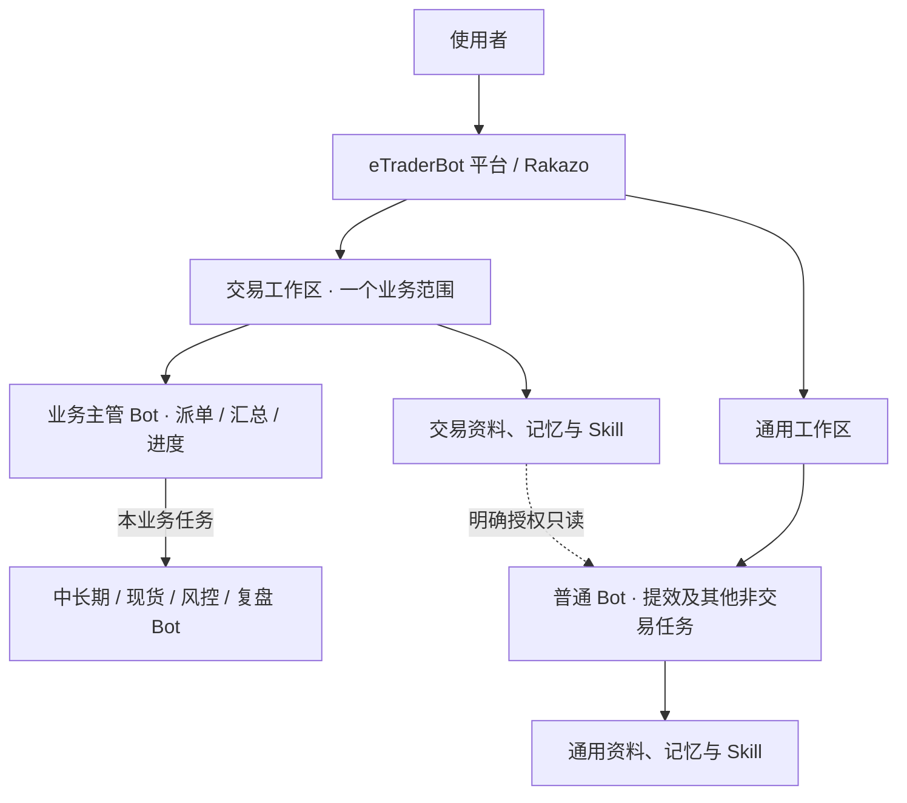
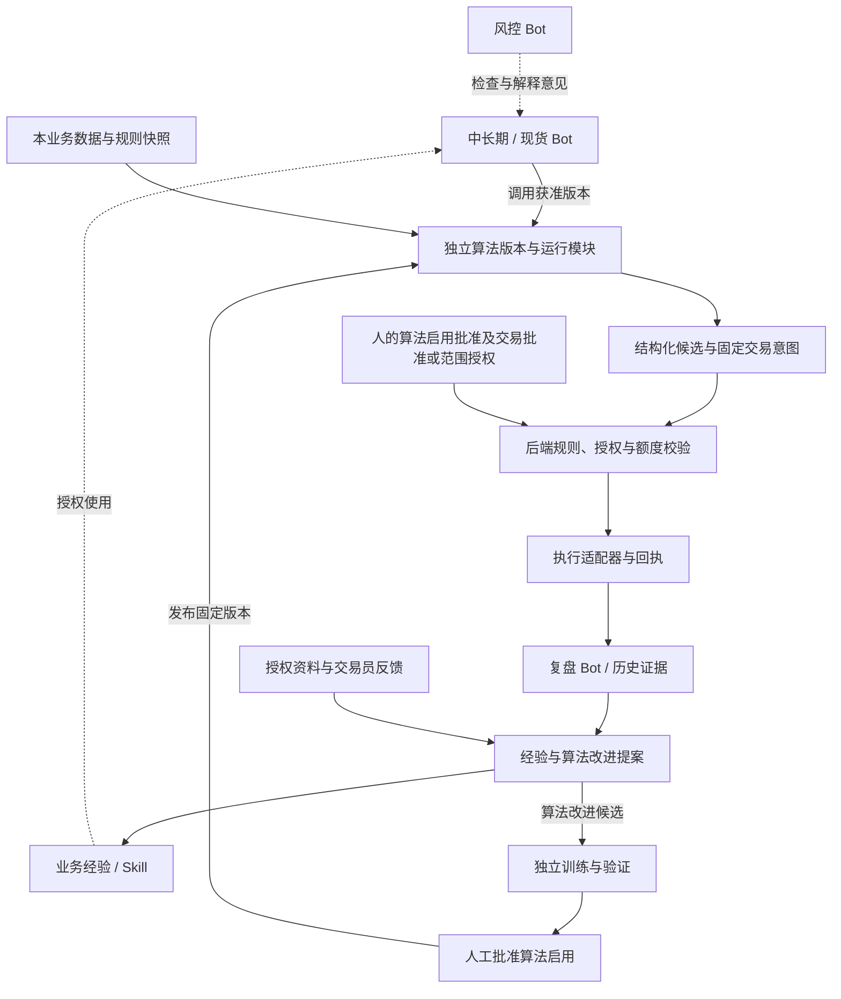
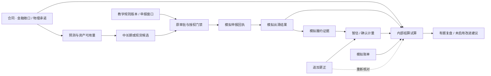

# eTraderBot 理想关系图（目标架构）

2026-11-04 更新。复用 Rakazo 承载 Bot 协作，Bot 通过记忆与 Skill 积累业务经验；影响交易决策的算法改进独立版本化，经过验证及人工启用。工作区分离已由使用者确认，具体权限决议见 [ADR 0004](../adr/0004-trading-general-workspace-isolation.md)。下图表示目标关系。工作区隔离首批已实施，范围见 [V1.1 实施说明](../implementation/eTraderBot-v1.1-workspace-isolation.md)；独立算法训练和完整经验交接尚未交付。

## 工作区归属

每条交易业务线固定一位主管，协调任务但不持有交易批准或执行权。

两个工作区并列，通用工作区不包裹交易工作区。地区用于组织具体业务；不同主体、账户或资产的资料与授权仍按业务范围管理。“全部 Bots”只汇总导航，不合并权限。

## 经验交接

默认采用固定版本导入，目标 Bot 随后独立积累，不持续订阅源内容。选择内容、来源与权限的决议见 [ADR 0005](../adr/0005-versioned-experience-handoff.md)，完整交接能力待实施。

源 Bot 后续修改不自动影响目标副本；复用新版本需再次明确接纳。交易权限与凭据不随经验交接继承。

## 交易与学习

经验与 Skill 支持业务协作和经授权的交接；影响交易决策的变化纳入受控算法或规则版本。新算法版本不继承旧交易授权。当前交付仍以合成数据、工程基线、参数候选和模拟执行为主，真实接口、独立强化学习及完整算法插件发布另行实施与验证。

## 2026-11-05：已交付的模拟业务周期

主管和四类专业 Bot 共同读取一个业务周期内的版本化证据。任务按需求分派并声明数据与前序任务依赖；图中的业务证据关系不是四个 Bot 的固定运行顺序。

当前仅实现 P25 的显式教学模拟和基本电量约束。现行三省规则、正式账单、跨业务资产承诺、复杂储能物理约束及实盘仍未验收。固定版本经验交接保持 ADR 0005 待实施状态。
