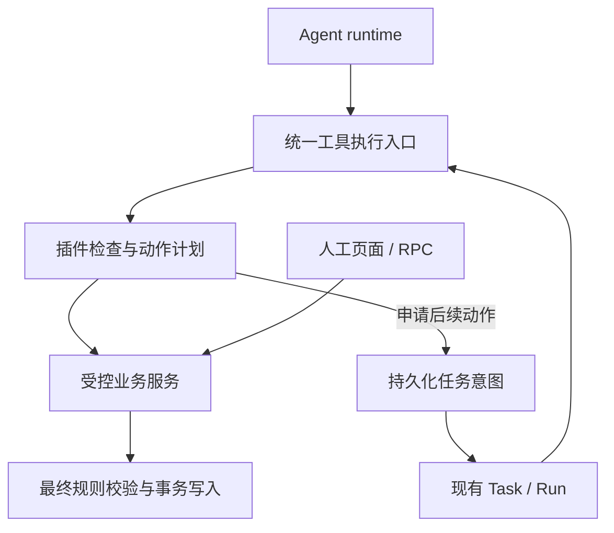

# eTraderBot 业务 Hook 插件框架 Spec

记录日期：2026-11-06

状态：`later`，设计方向已记录，尚未启动开发。使用者明确要求先保存 Spec 与待办，暂不实现。

本文记录业务与交易 Bot 的平台级插件框架方向。接口名称、存储结构和数值预算均需在后续启动时细化；本文不表示相关能力已经实现或通过验收。

## 1. 目标与首期范围

在现有平台执行层建立可复用的 Hook 插件框架，让关键业务动作遵守证据、流程和权限前提，并在被拒绝后有明确的补查、等待和恢复路径。分析过程继续由 Bot 自主安排。

使用者选择先建设通用框架，再逐步接入业务规则。第一版插件由平台开发者编写，随应用版本发布；首个示范插件为“缺少可获取的证据时自动补查”。首期以可重复的合成数据源验证闭环，真实业务接口另行接入。

框架接入现有 Agent runtime、工具执行、业务服务与 Task/Run，不替换现有编排机制。算法版本批准与交易授权保持独立；插件调用算法和工具，不自行取得批准资格。经验交接包不携带强制规则、插件执行权限或交易凭据。

## 2. 已确认的产品决策

| 决策 | 约定 |
|---|---|
| 首要目的 | 约束业务动作；经验自动整理和质量观测可作为后续插件方向 |
| 规则维护 | 平台维护强制规则，交易员配置允许调整的业务参数 |
| 参数作用域 | 业务工作区统一配置，单个 Bot 只能进一步收紧 |
| 自主边界 | 固定申报、提交正式结果、完成任务等动作的前提；不固定每一步读取和分析顺序 |
| 拒绝后的处理 | 可补查的信息继续补查，需要人工决定时等待；同一原因反复失败时停止无效重试 |
| 插件来源 | 平台编写、随应用发布的内部插件，首期不提供外部脚本安装机制 |
| 主动能力 | 插件可以调用工具、安排后续业务动作；参数和返回内容的变换受审计与最终校验约束 |
| 执行身份 | 继承触发 Bot 的身份和业务范围，并叠加插件自己的能力限制；跨专业工作正常派单 |
| 执行方式 | 检查和少量有界只读补查可同步；后续业务写操作持久化后交给现有 Task/Run 推进 |
| 交易写入 | 申报、撤单等统一经过受控业务接口；通用工具只保留被允许的分析和读取用途 |
| 参数与权限变化 | 执行时检查最新权限和约束；影响计算或批准依据的变化要求重算或重新批准，历史不改写 |
| 补查资料入库 | 登记且获授权的可信结构化来源通过校验后可自动入库；网页摘录、推断和历史经验需人工确认 |
| 补查后的继续 | 恢复原 Bot，让它结合新证据形成新请求；不直接重放旧业务请求 |
| 首期验收 | 使用合成数据源，区分确定性运行验证、真实模型效果和真实接口效果 |

## 3. 当前实现基础与差距

以下是设计记录时对现有代码路径的只读确认，不是新能力的验收记录。

- [统一工具执行入口](../../packages/adapters/src/run-tools.ts)已经执行工作区确认、请求准备、通用门禁、处理器调用与审计。
- [运行时接口](../../packages/adapter-kit/src/types.ts)已有工具执行及完成回调；[当前 runtime 适配器](../../packages/adapters/src/pi-runtime.ts)已有轮次与上下文处理。框架契约应保持运行时无关，具体 SDK Hook 只是适配接点。
- [交易服务](../../packages/db/src/trading-control.ts)承担算法批准、交易授权、额度和幂等检查；[业务周期服务](../../packages/db/src/business-cycle.ts)检查负责人、证据与前序任务、版本引用和完成条件。页面 RPC 也使用这些共享服务。
- 普通 Run 存在取得 shell、浏览器或连接器工具的路径，实际可用性取决于配置和其他门禁。通用审批不等于交易领域检查，不能仅给专用交易工具挂 Hook 就声称所有通道已被覆盖。此次没有调查实际交易凭据或外部端点可达性，不据此认定存在可利用的绕行缺陷。
- [现有插件安装](../../packages/adapters/src/plugin-connectors.ts)主要支持 Skill 和远程连接器，不执行插件仓库代码；不能把它视为已经具备可执行 Hook 安装能力。
- 当前外部正式证据导入要求人工身份，[服务](../../packages/db/src/business-cycle.ts)显式拒绝 Bot 导入，[RPC](../../apps/api/src/routes/business-cycle.ts)要求身份确认。Bot 工具没有通用外部证据拉取并入库操作。

因此，计划新增的能力包括插件注册与组合协议、受控后续动作、可信证据采集入口及补查恢复闭环。已有业务校验继续复用，避免维护两套不同的授权或证据规则。

## 4. 框架边界

### 4.1 接入位置

调用前检查提供及时的拒绝原因和恢复建议。涉及业务副作用的规则仍由共享服务针对最终参数和最新状态执行；人工 RPC、后台任务与 Bot 调用均受约束。前置检查不能消除检查后状态变化的可能，也不能代替事务内的授权、额度和版本检查。

后置 Hook 可以观察结果、提出后续动作，但不能撤销已经发生的副作用，也不能把服务端拒绝包装为成功。需要由业务成功触发的后续动作，应以持久化业务结果为依据，而非模型措辞或被改写的工具展示内容。

### 4.2 待细化的公共契约

| 契约 | 需要表达的内容 |
|---|---|
| 插件声明 | 稳定 ID、版本、适用作用域、触发阶段、能力声明、依赖和确定的执行顺序 |
| 执行上下文 | 服务端确认的用户、工作区、业务、周期、Bot、Task/Run、触发来源及规则/配置版本；不传递原始凭据 |
| 检查结果 | 允许、拒绝或等待，以及稳定原因码、具体缺口、可补查项、是否需要人工和允许的下一步 |
| 后续动作意图 | 目标动作、执行身份、业务范围、因果关联、去重依据、取消与重试约束 |
| 审计记录 | 插件版本、原始与最终请求、实际结果、检查结论、派生任务和最终执行状态；敏感内容按现有机制脱敏 |

这是语义清单，不是已发布的 TypeScript/RPC 接口。精确字段、错误码和存储映射留到启动后的契约阶段。

### 4.3 插件能力与执行规则

1. 平台强制规则不能被另一个插件的“允许”覆盖。插件禁用、配置缺失或检查失败不能默认放宽强制约束。
2. 有效能力受当前 Bot、业务授权及插件声明共同限制。平台维护插件不赋予它管理员身份；跨角色操作通过正常任务分配进行。
3. 参数变换保留原始请求，最终参数重新通过业务检查。影响决策或批准依据的变化按现有版本规则重新计算或批准；量价决策仍由独立算法产出。
4. 保留真实工具结果及来源。展示转换不能改写交易回执、证据状态或实际执行结论。
5. 插件主动调用工具时重新进入统一执行路径；记录因果链、限制递归触发和重复失败。不能以插件内部调用为由跳过检查。
6. 强制检查异常时停止对应写操作；纯观测插件失败只记录。耗时、调用次数、补查次数和递归深度应有平台限定预算，具体值后续确定。
7. 写入型后续动作先持久化，再由现有 Task/Run 和恢复机制执行。区分“已安排”和“已完成”，重复事件、重启和并发不能产生重复副本或重复交易。
8. 复用既有任务领取、事务、通知和恢复机制。不得用全局串行队列限制无关业务，也不建立第二套业务状态机。
9. 内部插件是随平台发布的受信任代码；受限调用接口不等同于外部代码沙箱。第三方可执行插件若以后开放，需要另行设计执行隔离。

### 4.4 参数与配置变化

强制规则由平台维护；业务负责人只可配置明确允许调整的参数。Bot 级配置的“收紧”关系应按字段定义，不能用任意配置覆盖或通用对象合并代替权限判断。

执行记录关联所使用的插件、规则与参数版本。权限撤销和约束变化在下一次动作执行时生效；涉及计算输入、算法版本或批准依据的变化使相关旧方案失效。无关配置变化无需无条件重办所有任务。已经完成的结果保留原始版本和历史。

## 5. 首个示范插件：证据补查

### 5.1 触发与分类

业务动作因缺少证据被拒绝时，返回结构化缺口。先区分：

- 当前周期已有正式证据但 Bot 尚未读取：重新读取并恢复分析。
- 确实缺少可从登记数据源获取的证据：按授权创建补查任务。
- 前序任务未完成：等待或按正常规则派单，不能伪造前序结果。
- 缺少人工批准、权限或数据源配置：说明原因并等待，不通过“补查”绕过。

### 5.2 可信采集与入库

新增受限的可信采集入口，保留现有人工导入规则。调用者请求采集业务、周期和证据类型；由服务选择获授权的登记来源并实际取数，不允许模型把任意内容自称为“权威接口返回”。

采集入口须明确新增能力的授予和撤销方式，并检查触发 Bot 的有效权限。它不借用人工身份、不自动获得管理员权限，也不向插件暴露交易凭据。

入库前检查业务归属、来源、时段、结构、单位和版本关系，保存来源记录 ID、采集信息及原始依据。重复采集幂等，更正追加版本链而非覆盖历史。合成数据保留合成标记；暂估数据不能仅因格式合法就被升级为确认数据。

网页摘录、模型推断和历史经验进入候选资料或现有人工确认流程。来源可信和结构校验不代表已经验证真实业务效果或语义结论。

### 5.3 恢复原任务

证据入库后复用现有依赖重算和通知机制，避免重复唤醒。恢复原 Bot，让它结合最新证据重新分析并形成新请求；执行时再次检查规则和批准。

补查失败或预算耗尽时保留已经取得的依据和具体缺口，进入可恢复的等待状态。保留原调查、未解决事项和历史版本；不能因为补齐一个数字就自动标记整个业务完成。

## 6. 首期验收要求（全部待实施）

| 编号 | 场景 | 期望 |
|---|---|---|
| H01 | 多插件组合、强制拒绝与后续允许冲突 | 顺序确定，强制规则不被覆盖 |
| H02 | 修改最终参数或执行前撤销权限 | 重新校验，旧批准不能放行变化后的动作 |
| H03 | 插件递归调用、重复触发、预算耗尽 | 所有调用经过门禁，有界停止且保留原因 |
| H04 | 业务/Bot/插件权限交集与跨角色请求 | 无跨业务越权，跨专业按正常任务流程执行 |
| H05 | shell、浏览器、连接器等通道 | 交易写能力受控；不能仅根据工具名或自报只读属性认定覆盖 |
| H06 | 强制检查异常与观测插件异常 | 前者阻止相应写入，后者不篡改业务结果 |
| H07 | 后续任务重复、并发、中断与恢复 | 可追溯且幂等，不重复产生业务副作用 |
| H08 | 合成来源补查成功 | 校验后追加带来源的正式证据，保留合成标记 |
| H09 | 来源未授权、错业务/时段、暂估、旧版本或冲突 | 拒绝、保留缺口或要求确认，不编造证据 |
| H10 | 缺前序任务或缺人工批准 | 不误判为可自动补查的外部证据 |
| H11 | 补证后恢复与再次提交 | 原 Bot 使用新证据生成新请求；历史和未解决事项保留 |
| H12 | 已有人工导入、交易、复盘和经验交接 | 原有授权、版本、幂等和来源边界不退化 |

先使用确定性的插件/数据源测试与隔离 PostgreSQL 验证事务和恢复，再验证真实 runtime 接线及适用页面。真实模型质量、真实接口、原生端与实盘效果单独报告，不从上述通过结果推断。

## 7. 后续任务与暂缓范围

任务拆分统一跟踪于 [已完成与待办 B3](../plans/eTraderBot-done-todo.md#b3-业务-hook-插件框架暂缓实施)，各项均为 `later`。

启动后顺序：现有执行路径与契约细化 → 内部插件注册和管线 → 受控后续动作与权限覆盖 → 可信采集入口及合成适配器 → 首例补查恢复 → 集成和界面验收。

首期不包含外部可执行插件市场、任意脚本热加载、真实交易接口、强化学习实现或模型质量提升承诺。本文保存后不自动启动这些工作。

## 8. 关联文档

- [V1 Spec](eTraderBot-v1-spec.md)
- [业务周期实现与验证边界](../implementation/eTraderBot-business-cycle.md)
- [固定版本经验交接决议](../adr/0005-versioned-experience-handoff.md)
- [已完成与待办](../plans/eTraderBot-done-todo.md)
